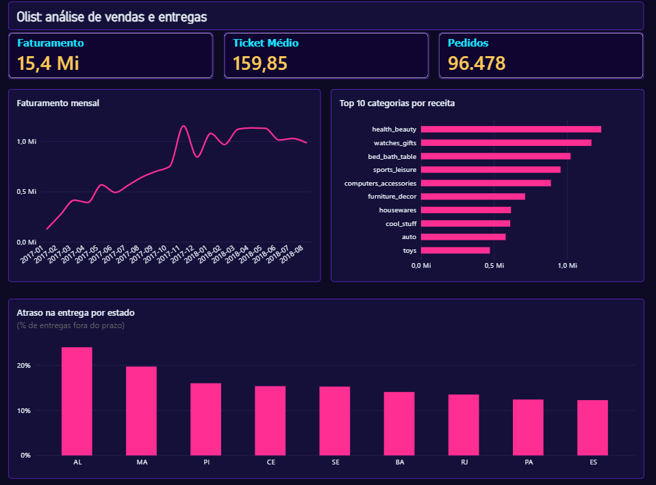
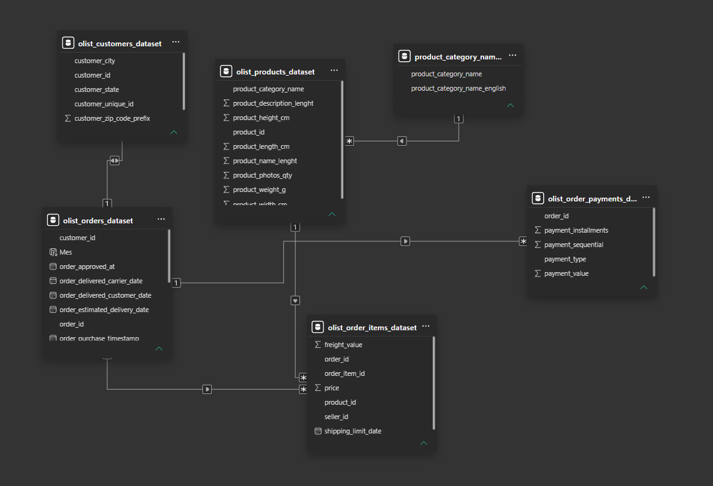
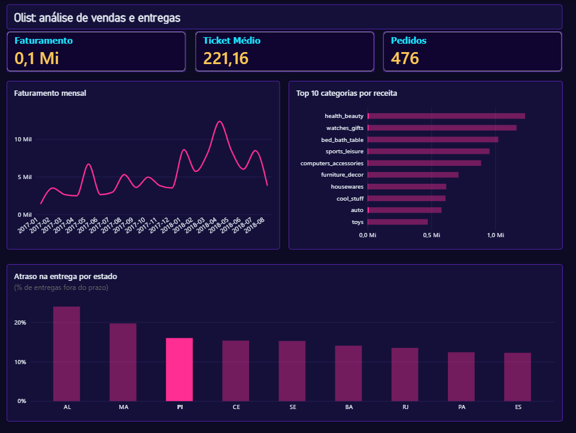

# Olist: análise de vendas e entregas

Dashboard em Power BI sobre o e-commerce brasileiro, com consultas em SQL para preparar e validar os dados.



## Problema

Entender como evoluíram as vendas, quais categorias geram mais receita e onde as entregas atrasam mais, para apoiar decisões comerciais e de logística.

## Dados

[Brazilian E-Commerce Public Dataset by Olist](https://www.kaggle.com/datasets/olistbr/brazilian-ecommerce) (Kaggle), com pedidos, itens, pagamentos, clientes e produtos. Os arquivos não estão neste repositório. Para reproduzir, baixe do Kaggle e coloque os CSVs na pasta `dados`.

## Ferramentas

SQL (SQLite), Python e Pandas (para carregar os CSVs), Power BI (Power Query, modelagem e DAX).

## Como foi feito

1. **Carga:** script em Python (`criar_banco.py`) que cria um banco SQLite a partir dos CSVs.
2. **SQL:** três consultas em `sql/` para faturamento mensal, top categorias e atraso por estado.
3. **Power Query:** tratamento de tipos e datas.
4. **Modelo:** relacionamentos entre pedidos, itens, pagamentos, clientes, produtos e tradução de categorias.
5. **DAX:** medidas de faturamento, pedidos, ticket médio e percentual de atraso.
6. **Validação:** os números do Power BI foram conferidos com os do SQL.



## Principais números

- **96.478** pedidos entregues e **R$ 15,4 mi** de faturamento, com ticket médio de **R$ 159,85**.
- **Categorias:** `health_beauty` lidera em receita de produtos (R$ 1,23 mi), seguida de `watches_gifts` (R$ 1,17 mi) e `bed_bath_table` (R$ 1,02 mi).

## Insights

1. **Ticket por categoria:** `bed_bath_table` tem mais pedidos que `watches_gifts` (9.272 contra 5.495), mas o ticket de `watches_gifts` é quase o dobro (cerca de R$ 212 contra R$ 110 por pedido).
2. **Atraso no Nordeste:** os maiores percentuais de entrega fora do prazo estão no Nordeste: AL (23,9%), MA (19,7%), PI (16,0%), CE (15,3%), SE (15,2%) e BA (14,0%).
3. **Sazonalidade:** o faturamento tem um pico em novembro de 2017 (R$ 1,15 mi) e cai em dezembro. É possível que seja efeito da Black Friday, mas isso precisaria ser confirmado com uma análise por dia.

## Interatividade

Ao clicar em um estado, os cartões e os gráficos filtram juntos. Exemplo com o Piauí:



## Decisões e cuidados

- Só pedidos com status `delivered`.
- **Faturamento** usa o valor pago (inclui frete). **Receita de produtos** usa o preço do item (sem frete). Por isso os dois valores não são comparáveis entre si.
- O gráfico mensal começa em 2017, porque os meses de 2016 têm pouquíssimos pedidos.
- O gráfico de atraso mostra os estados com pelo menos 300 entregas, ordenados pelo percentual de atraso (máximo de 10), para evitar distorção em estados com poucas entregas.
- **Aprendizado:** o Power BI em português leu o ponto decimal dos CSVs como separador de milhar, o que multiplicou o faturamento por 100. A conferência com o SQL mostrou o erro, que foi corrigido importando com a localidade em inglês.

## Estrutura

```
sql/                  consultas
img/                  prints
criar_banco.py        carga dos CSVs no SQLite
dashboard_olist.pbix  relatório do Power BI
tema.json             tema visual do Power BI
```